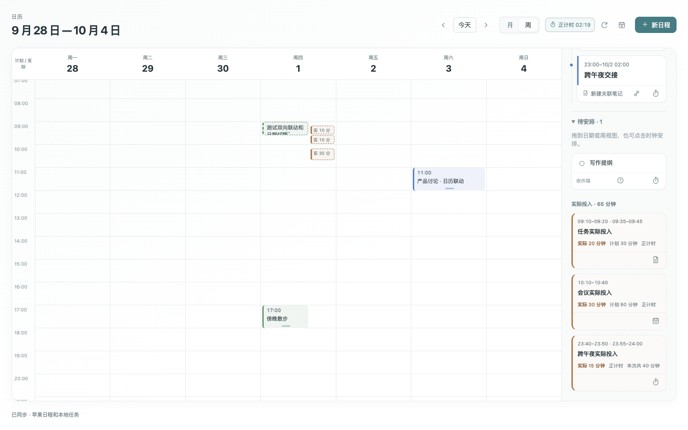

# ThoughtSpace Calendar & Journal

A standalone Obsidian desktop plugin connecting daily and periodic notes, Markdown tasks, a sidebar calendar, and a large month/week calendar.

[中文详细介绍](README.md) · [Download](https://github.com/YuguangLi-lab/obsidian-thoughtspace-calendar/releases/latest) · [Issues](https://github.com/YuguangLi-lab/obsidian-thoughtspace-calendar/issues)

Current release: **[1.5.4](https://github.com/YuguangLi-lab/obsidian-thoughtspace-calendar/releases/tag/v1.5.4)**. Use the complete ZIP for the bundled native Apple Calendar helper.

## Clearer timer and compact lunar labels in 1.5.4

The timer uses a large clock beside a small progress ring, fewer frames, and compact native controls. Lunar labels use 9px, or 8px in narrow/compact layouts; regular date cells shrink from 44px to 40px. Existing sessions, records, notes and Obsidian theme fonts are preserved. [Release notes](docs/RELEASE-1.5.4.md) · [Verification](qa/RELEASE-VERIFY-1.5.4.json).

## One calendar and timer surface in 1.5.3

The Calendar / Timer tabs now contain the complete stopwatch, countdown and Pomodoro controls, presets, custom duration, activity title and history. Tasks remain below. The standalone timer sidebar and ribbon entry are removed; task, timeline, large calendar, status bar and existing command shortcuts open this same calendar timer.

Saved timer panes automatically merge into the calendar, including deferred workspace views. Migration preserves calendar navigation and does not steal focus when you return to a note. Switching tabs and refreshing tasks retain timer form drafts and focus. Record actions open the large calendar on the corresponding day to show actual work. Existing sessions, records and settings are retained.

Verified with 467 unit tests, 21 integrated-timer browser checks, 65 large-calendar browser checks, 18 native navigation/data checks and 29 official Tasks API contract checks. The 101 existing test notes and paused timer state were preserved; native checks did not start or stop that session or write Apple events.

[Release notes and upgrade](docs/RELEASE-1.5.3.md) · [Verification](qa/RELEASE-VERIFY-1.5.3.json)


## Focus panel in 1.5.2

The timer tab now provides a larger clock, progress ring, phase and current activity, with a clear start/pause/resume action. The calendar still uses an exclusive tab, tasks stay below, and journal strips remain compact. All surfaces subscribe to the same timer, preserving active sessions and native theme fonts.

[Release notes](docs/RELEASE-1.5.2.md) · [Verification](qa/RELEASE-VERIFY-1.5.2.json)

## Compact sidebar and shared focus in 1.5.1

Month/year navigation is combined, with less frequent calendar actions in the menu. Calendar and timer share an exclusive tab area, leaving more room for tasks. Journal and period lists control the same focus session. Task scopes, empty states and diary headings are more compact; native Markdown rendering and body fonts remain in use.

[Release notes](docs/RELEASE-1.5.1.md) · [Layout references](docs/SIDEBAR-DESIGN.md) · [Verification](qa/RELEASE-VERIFY-1.5.1.json)

## Timer and calendar in 1.5.0

Use stopwatch, countdown or Pomodoro modes. Start a planned task/event with its duration, or track an untimed activity. Pause/resume excludes inactive time; stop saves the actual session. Month cells show daily tracked time, week columns show separate active segments, and the selected-day history compares planned and actual duration. A live timer entry opens the same sidebar. Clock ticks update text without rebuilding the grid or querying Apple Calendar. Tracking does not modify task completion, recurrence or Apple events.

[Release notes](docs/RELEASE-1.5.0.md) · [Reference projects](docs/TIMER-REFERENCES.md)


<details>
<summary>Dark sidebar and planned/actual calendar</summary>




</details>

## What changed in 1.4.5

- Queue schedule, priority and completion edits on one task while retaining verified previous changes.
- Protect new recurring occurrences from stale attribute actions and undo, including tasks that just gained a repeat rule.
- Complete recurring items after quadrant changes; retain nested list indentation and block references.
- Keep focus on the existing task when an identical next occurrence appears, and retain each quadrant's scroll position.
- Unify calendar, journal and task surfaces; separate tags/repeat rules from task titles without changing the source. Busy month cells condense previews while retaining full agenda access.
- Select a time range on the empty week grid, or in task scheduling dialogs; extend duration with the end handle. Typed minutes remain exact. Drag timeline tasks to time targets or the large calendar. Escape cancels only an active selection.
- Apply timeline search and tags while calculating conflicts against the complete day. Refine the compact rail, source labels and visible actions.

See [local release notes](docs/RELEASE-1.4.5.md) and the [verification report](qa/RELEASE-VERIFY-1.4.5.json). Preserve `data.json` and notes when upgrading.

## Features

- Large calendar with a six-week month grid and a seven-day hourly week view.
- All-day events, overlapping lanes, and a selected-day agenda combining timed Markdown tasks with Apple events.
- Drag unfinished tasks from lists, quadrants, or the unscheduled tray into the calendar. Move tasks/events and resize their end in the week view, with 15-minute pointer snapping.
- Task scheduling dialogs offer a drag-select time rail and boundary handles, while retaining exact typed minutes. An empty week-grid drag opens a pre-filled event draft without saving early.
- Resizing uses live week-grid coordinates after scrolling or pane changes. A floating label keeps short ranges readable; editing stays locked until saved data reaches the grid, and failed saves can be retried in place. Timeline drop refreshes are coalesced.
- Create a linked event note or choose an existing Markdown note through native Obsidian search.
- Separate sidebar calendar and journal views; daily, weekly, monthly, quarterly, and yearly notes.
- Offline Chinese lunar dates, festivals, solar terms, and built-in mainland holiday/workday data through 2026.
- Daily note folders by year/month; reuse existing root-level notes and optional backed-up filing.
- Links to notes created on the selected day, quick Markdown capture, and native note editing.
- Task lists with search, tags, date scopes, sorting, grouping, time scheduling, source navigation, and undo.
- Fixed 2×2 Eisenhower quadrants, including in narrow sidebars; drag tasks to classify them.
- A daily timeline with timed items, conflicts, and free gaps.
- Obsidian theme/font integration and pane-width-based layouts.
- Experimental Apple Calendar read/create/update integration on macOS 14+ using EventKit.


The screenshot is an isolated UI test preview with synthetic events, not proof of real calendar synchronization.

## Install

Obsidian desktop 1.6.0+ is declared in the manifest. Mobile is not supported. Apple Calendar requires macOS 14+ on Apple Silicon or Intel. Core Windows/Linux behavior has not undergone native validation.

1. Download the complete `thoughtspace-calendar-<version>.zip` available on Releases.
2. Extract it into `.obsidian/plugins/thoughtspace-calendar/` inside your vault.
3. Keep `manifest.json` directly inside that folder and retain the complete `native/` app bundle.
4. Enable **ThoughtSpace 日历与日记** in Community plugins. Reload after updating.

The three standalone runtime assets do not include the Apple Calendar helper. Download the complete ZIP when using Apple Calendar. This project is distributed through GitHub Releases and does not claim Community plugin listing approval.

When updating, preserve `data.json` and other personal files. The source installer backs up existing files and checks hashes before promotion:

```sh
node scripts/install.mjs '/path/to/your/vault'
```

The installer requires an existing valid `.obsidian/community-plugins.json`. ThoughtSpace whiteboard 0.94.0+ is needed if both plugins are enabled.

## Markdown tasks

```markdown
- [ ] 09:00 - 10:00 Draft proposal ⏳ 2026-10-01 ⏫ #work
- [ ] Review notes 📅 2026-10-03
- [x] Finish weekly review ✅ 2026-10-01
```

Tasks stay in their source files. Date/time/priority actions preserve block references and verify the original line before writing. With **Tasks 7.2+** enabled, recurring items marked with `🔁`, `[repeat:: …]` or `(repeat:: …)` can be completed through the [official Tasks API](https://github.com/obsidian-tasks-group/obsidian-tasks/blob/main/docs/Advanced/Tasks%20Api.md). Tasks controls recurrence generation and ordering; undo checks the complete changed span. Without that API, recurring checkboxes remain disabled. Ordinary tasks keep their existing completion behavior. Unsupported custom checkbox statuses or deletion results are rejected with guidance to use the original note. This is not complete Tasks-specification support. Before writing, the integration verifies that the next occurrence was actually generated; a missing global filter, invalid rule or format mismatch cannot silently finish the task. A single completed row can also mean a finite rule ended; because the public API does not distinguish these cases, finish such a task in its source note. Dataview dates and priority are indexed and retained during scheduling. The integration blocks a stale calendar checkbox while a change made by Tasks is awaiting indexing, including undated recurrences whose next occurrence has identical text. Refreshing then allows normal interaction.

Dropping on a date changes the scheduled date and keeps the existing time. Dropping on the week grid sets time while retaining a known duration, or uses 30 minutes by default. A distinct deadline remains a reminder instead of a second draggable time block. Tasks remain within one day; ranges stop at 23:59.

The selected-day agenda offers a mixed timeline, untimed daily tasks, completed items, and an unscheduled tray. Scheduling a Markdown task writes its original line; it does **not** create an Apple event.

## Apple Calendar

Connect explicitly from the plugin settings or the large-calendar connection dialog. Grant system full calendar access, choose visible calendars, and select a writable default. Loading the plugin alone never requests permission; an empty visible-calendar selection means none.

Supported fields: title, start/end, all-day, calendar, location, and full notes. Read-only calendars are view-only. Repeating events are updated for the current occurrence. A revision check preserves the draft on conflicts; uncertain saves are not retried automatically.

Only the first-day segment of a multi-day event can be dragged to move it; its final segment can be resized in the week view. All-day events move between dates or all-day areas, not into hourly slots. Read-only events cannot be moved or resized.

Event-note links use the native list property `thoughtspace-calendar-events`. Links stay in Markdown and follow native note renames. Creating a note or linking an existing one does not upload note contents or vault paths to Apple. Initial note dates are a creation-time snapshot; event edits do not rewrite its body.

External changes appear on manual refresh, window focus, or the visible-page refresh timer. Cloud synchronization belongs to macOS Calendar, not this plugin. Deletion, reminders, recurrence-rule editing, instant push sync, and automatic Markdown-task conversion are not included.

The universal helper is ad-hoc signed, not Apple Developer ID notarized. Review and rebuild the Swift source if required by your system policy.

**Experimental:** native input validation, status calls, and fixture-based editor flows were tested. Real authorization, real event read/write roundtrips, and account cloud synchronization remain unverified.

## Development and validation

```sh
npm ci
npm run build
npm test
npm run build:native       # macOS + Xcode Command Line Tools
npx playwright install chromium
npm run test:browser
npm run package           # macOS
```

Node.js 22+ is recommended. Version 1.4.5 passes 365 unit tests, 133 native Tasks checks, 41 native workflow checks, 48 large-calendar browser checks, 31 week-grid drag checks, 115 time-range interaction checks, 28 layout cases and 29 upstream Tasks API checks. The 101 original test-vault notes retain identical hashes. See the [verification report](qa/RELEASE-VERIFY-1.4.5.json) and [test methodology](docs/TESTING.md). Real Apple Calendar access was not exercised; short runs do not establish long-term memory stability.

More detailed Chinese guides: [Usage](docs/USAGE.md), [Apple Calendar](docs/APPLE-CALENDAR.md), [Development](docs/DEVELOPMENT.md).

## License and acknowledgments

[MIT](LICENSE). Third-party licenses and references are recorded in [THIRD_PARTY_NOTICES.md](THIRD_PARTY_NOTICES.md), including lunar-typescript, Radix Colors, and Chinese Calendar. This is not an official Obsidian or Apple product.
