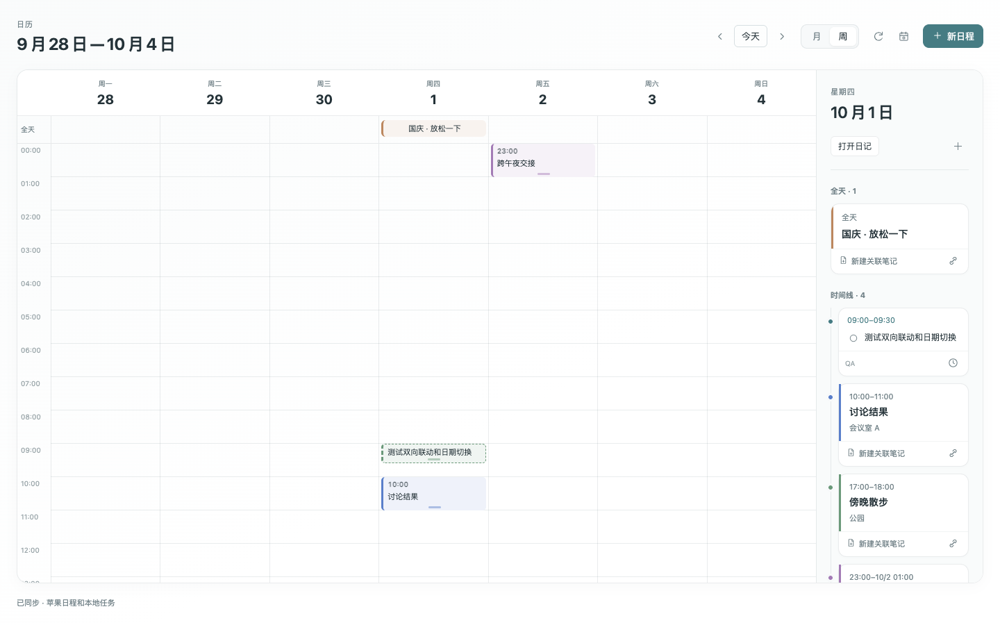
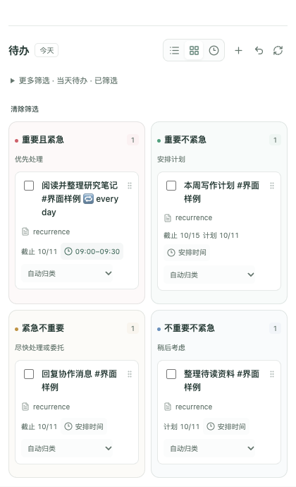

# ThoughtSpace 日历与日记

**把日历、日记和 Markdown 待办放进同一个 Obsidian 工作流。**

独立运行的桌面插件：用主工作区的大日历查看整月和每周安排，用侧栏月历切换日期，用日记记录想法，再通过列表、四象限和时间线组织笔记中的任务。macOS 上还可以连接苹果日历，在插件内查看、新建和修改日程。

[](https://github.com/YuguangLi-lab/obsidian-thoughtspace-calendar/releases/latest)
[](https://github.com/YuguangLi-lab/obsidian-thoughtspace-calendar/actions/workflows/verify.yml)
[](LICENSE)

[下载安装包](https://github.com/YuguangLi-lab/obsidian-thoughtspace-calendar/releases/latest) · [使用指南](docs/USAGE.md) · [苹果日历设置](docs/APPLE-CALENDAR.md) · [English](README.en.md) · [反馈问题](https://github.com/YuguangLi-lab/obsidian-thoughtspace-calendar/issues)

> 当前版本 **1.4.4**。本版重点改善 Tasks 重复任务的连续操作与时间线编辑。苹果日历仍为实验功能，真实系统日程读写未纳入本版验证。

## 1.4.4 更新重点

| 改进 | 现在的体验 |
| --- | --- |
| 连续完成重复任务 | 同篇笔记中连续勾选不同任务，前一项生成下一次任务后，后续排队操作仍能正确定位 |
| 保留冲突保护 | 同一任务重复点击、外部改动和过期索引仍被拦截，避免误完成下一次任务 |
| 轻量时间线刷新 | 分钟刷新只更新时间和进行中状态，保留卡片、键盘焦点与已展开内容 |
| 直接编辑时间 | 点击时间线卡片顶部的时间，修改计划日期、开始／结束时间和优先级 |
| 更清晰的任务卡片 | 正文、来源、日期、时长分层呈现；来源名称常驻底部，长名称省略显示 |
| 窄侧栏与深色主题 | 保持可读的间距和操作入口；四象限始终维持 2×2 |

[完整更新说明](docs/RELEASE-1.4.4.md) · [下载 1.4.4 完整安装包](https://github.com/YuguangLi-lab/obsidian-thoughtspace-calendar/releases/download/v1.4.4/thoughtspace-calendar-1.4.4.zip) · [验证报告](qa/RELEASE-VERIFY-1.4.4.json)

## 界面预览


*隔离界面测试中的月视图，日程与笔记均为合成示例。实际界面的字体、颜色跟随 Obsidian 主题。*

<details>
<summary>查看周时间格与窄分栏预览</summary>




</details>

<details>
<summary>任务列表、四象限与时间线（1.4.4 合成样例）</summary>





</details>

## 能做什么

| 模块 | 功能 | 使用场景 |
| --- | --- | --- |
| 大日历 | 月视图、周视图、完整六周日期、当天标记、日期切换 | 查看整月安排，规划一周 |
| 周时间格 | 全天区域、24 小时网格、重叠日程分列、定时 Markdown 任务 | 直观看出时间占用 |
| 当日详情 | 定时任务与苹果日程合并时间线、待安排区、日记和笔记入口 | 从计划进入实际笔记 |
| 拖动排期 | 列表/四象限拖入大日历、月/周拖动、周视图调整结束时间 | 减少安排任务时的重复输入 |
| 日程笔记 | 新建关联笔记、关联已有笔记、原生属性保存关系 | 随时打开会议记录和准备材料 |
| 侧栏日历 | 月历、年历、周编号、农历、节气、节日和休班标记 | 写作时随手查日期 |
| 日记与清单 | 日记、周记、月记、季记、年记；年月目录 | 日常记录和周期回顾 |
| 新建笔记关联 | 将当天新建笔记链接到当天日记 | 找回当天的工作与思考 |
| 收集笔记 | 快速记录，保存为普通 Markdown 文件 | 临时想法和资料收集 |
| 任务列表 | 全库待办、日期与标签筛选、搜索、排序、分组 | 管理分散在笔记里的任务 |
| 四象限 | 固定 2×2 布局、拖动分类、菜单调整 | 按重要程度与紧急程度安排 |
| 时间线 | 开始/结束时间、时间冲突提示、空档展示、当前时间 | 安排一天的执行顺序 |
| 苹果日历 | 读取所选日历、新建/修改日程、只读日历查看 | 把系统日程放到笔记旁边 |
| 原生联动 | 原文编辑、Markdown 任务、主题与正文字体、页签状态恢复 | 延续 Obsidian 的使用习惯 |

### 大日历：看全局，也能进入细节

- 在主工作区打开，月视图固定显示 42 个日期格；周视图展示七天的小时网格。
- 月格最多显示三条日程摘要，其余通过数量入口查看；当日详情分批加载。
- 从任务列表、四象限或右侧“待安排”拖到日期，即可修改计划日；拖到周时间格可直接安排时间。
- 周视图中的任务和可写苹果日程支持移动及底部调整结束时间，拖动按 15 分钟吸附；任务的时钟入口支持按分钟精确输入。
- 当日时间线按开始时间混合展示定时任务和苹果日程；全天日程、未定时待办及已完成任务分别收纳。点击任务标题打开原文行。
- 日程下方可新建关联笔记，或用链接图标选择已有笔记；关联使用 Obsidian 原生属性保存在笔记中。
- 点击周视图空白时间格，可创建该日期和时间的苹果日程。
- 窄分栏按**当前页签宽度**调整布局；周视图刷新保留滚动位置。
- 当前日期、月/周模式和浏览位置可随工作区恢复；多个入口复用同一页签。

### 日记：文件仍是你的 Markdown

新建日记默认按年、月保存，例如：

```text
日记/
└── 2026/
    └── 10/
        └── 2026-10-01.md
```

目录名称可设置。旧目录中已经存在的日期日记会优先复用，不在启用插件时批量移动。日记包含想法、任务和阅读关联区；当天新建笔记以链接关联，不复制正文。

侧栏日历与日记清单是独立页面。点击日期、周编号、月份和年份，可进入相应记录；日记正文使用 Obsidian 的正文字体，编辑仍在原生 Markdown 页面中进行。

### 任务：一份原文，三种组织方式

任务直接从仓库的 Markdown 复选框中读取。安排日期、时间、优先级和完成状态写回原始任务行，保留块引用和其他内容。

```markdown
- [ ] 09:00 - 10:00 写项目方案 ⏳ 2026-10-01 ⏫ #工作
- [ ] 整理读书笔记 📅 2026-10-03 #阅读
- [x] 完成周回顾 ✅ 2026-10-01
```

- **列表**：当天、未完成、逾期、未来七天、未安排、当天完成和全部已完成；按标签筛选，按优先级、日期、来源或时间排序。
- **四象限**：拖动任务到“重要且紧急 / 重要不紧急 / 紧急不重要 / 不重要不紧急”；窄侧栏仍保留四象限。
- **时间线**：按具体时间展示当日任务，查看时间冲突和空档。列表和四象限中也能安排具体时间。
- **来源与撤销**：点击来源打开原文；支持撤销上次任务操作。原文已经变化时拒绝覆盖，提示刷新。
- 代码围栏、代码片段和隐藏注释中的示例不会作为普通待办；支持 Callout 中的任务。

启用 **Tasks 7.2 或更新版本**后，含 `🔁`、`[repeat:: …]` 或 `(repeat:: …)` 的重复任务可在本插件勾选，由 [Tasks 官方 API](https://github.com/obsidian-tasks-group/obsidian-tasks/blob/main/docs/Advanced/Tasks%20Api.md) 处理重复规则和下一次任务。未安装兼容版本时，该复选框保持禁用。普通任务继续原有完成逻辑；自定义复选状态、完成后删除等暂不支持的 API 返回结果会停止写入，并提示到原文处理。本插件并未实现完整 Tasks 规范。写回前会验证下一次任务实际生成；未生成时保留原文，并提示检查全局过滤器、重复规则和任务格式。已结束的重复规则请在原文完成。Tasks 在原文生成下一次任务而日历尚未刷新时，会阻止旧复选框再次完成同一任务；刷新后可继续操作。详见 [配置示例](docs/USAGE.md#tasks-重复任务)。

给 Markdown 任务安排时间仍只修改原笔记，**不会自动创建苹果日程**；两种事项在大日历中一起展示，各自保留原来的数据来源。

## 安装

### 环境要求

| 项目 | 要求 |
| --- | --- |
| Obsidian | 桌面版，清单最低版本为 1.6.0 |
| 核心日历/日记/任务 | 不依赖 ThoughtSpace 白板或苹果日历连接 |
| 苹果日历联动 | macOS 14+，Apple Silicon 或 Intel |
| 移动端 | 当前未支持；插件标记为桌面专用 |
| Windows / Linux | 苹果日历接口不可用；核心功能尚未进行这两个系统的原生验证 |

### 手动安装

1. 从 [最新 Release](https://github.com/YuguangLi-lab/obsidian-thoughtspace-calendar/releases/latest) 下载名称为 **`thoughtspace-calendar-版本号.zip`** 的完整安装包。
2. 解压，将内容放入你的 Obsidian 仓库 `.obsidian/plugins/thoughtspace-calendar/`。
3. 确认 `manifest.json` 直接位于该插件目录下，没有多套一层同名文件夹。
4. 打开 Obsidian 设置 → 第三方插件，启用 **ThoughtSpace 日历与日记**。更新安装后重新加载插件。

```text
.obsidian/plugins/thoughtspace-calendar/
├── main.js
├── styles.css
├── manifest.json
└── native/
    └── ThoughtSpaceCalendarBridge.app/
        └── Contents/
            ├── Info.plist
            ├── MacOS/calendar-bridge
            └── _CodeSignature/CodeResources
```

**需要苹果日历时请使用完整 ZIP。** 单独下载三个 JavaScript/CSS/manifest 文件不会带上原生桥接程序。`native/` 的目录结构和可执行权限必须保留。

本项目通过 GitHub Release 手动分发，目前未声明已经进入 Obsidian 社区插件市场。安装前可用同一 Release 对应版本的 `SHA256-版本号.json` 或 `FILES-版本号.txt` 核对文件。

### 更新与旧日历迁移

- 更新只替换运行文件和 `native/`，保留原有 `data.json`、笔记和个人设置。
- 与 [ThoughtSpace 白板](https://github.com/YuguangLi-lab/obsidian-thoughtspace) 同时使用时，白板需为 **0.94.0 或更新版本**，避免旧内置日历重复注册。
- 独立插件第一次启用时，仅读取旧白板配置中的日历相关设置；不改写白板配置，不迁移苹果日历授权。
- 若需要把旧根目录日记归档到年月目录，使用设置里的“整理旧日记”。会先备份，目标同名时跳过。
- 本地源码工程可运行 `node scripts/install.mjs '/path/to/your/vault'`。安装脚本备份旧插件和启用列表，保留用户文件，校验后替换；失败时回滚。

## 快速开始

1. 点击左侧工具栏 **ThoughtSpace 日历**，打开右侧“日历与任务”。
2. 点击日期，进入该日日记；点击“编辑日记”在原生 Markdown 页面中写作。
3. 点击 **打开大日历**，从侧栏列表或四象限拖入任务；周时间格可直接排期，时钟按钮可精确修改日期和时间。
4. 在任务区用图标切换列表、四象限和时间线；用“更多筛选”调整范围、标签和排序。
5. macOS 用户可通过“大日历与苹果日历”连接页面授权并选择日历。

命令面板也提供以下入口：

| 命令名称 | 作用 |
| --- | --- |
| 打开日历与任务 | 打开侧栏日历与待办 |
| 打开日记与清单 | 打开独立日记页面 |
| 打开今日日记 | 创建或复用今日日记 |
| 打开大日历 | 在主工作区查看月/周日程 |
| 苹果日历连接与选择 | 授权、选择显示日历和默认可写日历 |
| 收集笔记 | 快速创建 Markdown 笔记 |
| 整理旧日记到年月目录 | 备份后归档旧日期笔记 |

## 苹果日历双向联动

**数据来自 macOS 系统 EventKit。** 插件不直接操作苹果日历数据库，不需要填写 iCloud 密码，也不自行实现云端账户同步。

1. 在大日历右上角打开日历设置，或通过插件设置打开连接页面。
2. 点击“连接苹果日历”，在系统提示中允许完整读写权限。启动插件和打开日历不会自动请求权限。
3. 勾选要显示的日历，并选择一个可写的默认日历。勾选为空表示不显示任何日历。
4. 在插件内创建日程，或点击已有日程修改标题、日期、时间、全天状态、目标日历、地点和备注。

| 行为 | 当前实现 |
| --- | --- |
| 插件 → 苹果日历 | 通过 EventKit 创建和修改日程 |
| 苹果日历 → 插件 | 手动刷新、窗口重新获得焦点、可见页面定时刷新 |
| 只读/订阅日历 | 可以查看，不允许保存修改 |
| 重复日程 | 修改当前场次；不编辑整套重复规则 |
| 拖动和缩放 | 可写日程支持改期和周视图调整结束；保存前加载完整备注并检查版本 |
| 日程关联笔记 | 关系保存在本地笔记属性，不向苹果日历上传笔记正文 |
| 多处同时编辑 | 保存前检查日程版本，冲突时保留草稿 |
| 保存超时/结果不明 | 不自动重试；先刷新确认，避免重复创建 |
| 全天日程 | 界面结束日为包含的最后一天，内部转换为排他结束时间 |
| 断开连接 | 停止插件读取；系统权限仍由 macOS 设置管理 |

当前**不包含**删除日程、苹果提醒事项、重复规则编辑、Markdown 任务自动转为苹果日程，也不是即时推送同步。完整操作、权限和故障排查见 [苹果日历指南](docs/APPLE-CALENDAR.md)。

## 个性化设置

| 设置 | 可调整内容 |
| --- | --- |
| 日记目录 | 新日记保存的根目录；修改不会自动搬动旧文件 |
| 收集笔记目录 | 快速收集笔记的保存位置 |
| 当天笔记关联 | 是否将当天新建笔记链接到日记 |
| 农历/节日/节气/休班 | 分别控制显示 |
| 日历密度 | 舒适、紧凑 |
| 界面风格 | 柔和、纸张 |
| 主题色 | 森林绿、蓝色、琥珀、玫瑰 |
| 玻璃效果 | 开启或关闭 |
| 苹果日历 | 连接状态、显示日历、默认可写日历 |

样式限制在插件自身容器中，字体沿用 Obsidian 设置。农历计算在本地离线运行；内置中国大陆调休数据覆盖到 **2026 年**，未收录年份不猜测休班安排。

## 流畅性和数据保护

- 日历和任务页复用同一个任务索引；初次加载后只更新发生变化的文件。任务内容未变时保留现有条目，不重复通知界面刷新。
- 一次任务写入合并为一次索引通知；列表勾选后恢复任务操作焦点，避免键盘操作因重绘中断。
- 苹果日程只查询可见范围：最大 62 天、最多 2,000 条；范围缓存最多 12 个，同类并发请求合并。
- 日期切换、断开连接和关闭插件后，过期结果不会写回当前界面。
- 日程保存与设置写入排队执行，防止旧表单覆盖较新的设置。
- 月格摘要、任务和当日详情控制单次渲染量；关闭页面时释放监听和计时器。
- 任务修改检查原文行，Tasks 生成的重复任务按完整替换区间撤销；不覆盖其他正文编辑。
- 拖动期间保留当前界面，减少索引刷新造成的中断；跨面板传递随机令牌，不把任务原文放进拖动载荷。
- 计划日与截止日不同的任务，截止日显示为提醒，不作为第二个可拖动时间块。

这些机制降低重复读取和意外覆盖的风险。大规模库、跨平台运行和长期内存表现仍需要持续验证。

## 验证结果与范围

1.4.4 的验证结果如下。原生检查使用专门测试库和官方 Tasks 8.5.0，包含实际文件写回、Tasks 索引与界面操作。

| 验证层级 | 通过数量 | 覆盖内容 |
| --- | ---: | --- |
| 单元测试 | 280 | 任务解析、连续写入、冲突检查、撤销等 |
| 真实 Tasks 联动 | 57 | 列表／四象限／时间线连续勾选、下一次任务、大日历联动、时间编辑 |
| 原生日历工作流 | 36 | 排期、来源与属性关联、布局和状态恢复 |
| 浏览器交互 | 30 | 月／周视图、拖动、时间调整与界面交互 |
| 布局组合 | 12 | 280／420 像素宽度、深浅色、三种任务视图 |
| 官方 Tasks API 契约 | 19 | 重复规则、配置与返回结果兼容性 |

连续操作测试在列表、四象限和时间线分别快速勾选 6 条重复任务，并撤销最后一条；全部通过。101 篇原有测试笔记 SHA256 未变，临时笔记与 Tasks 设置已恢复。计时器检查确认卡片 DOM 和焦点保留；这不代表长期内存或所有大库场景的性能保证。

[本版详细验证记录](qa/RELEASE-VERIFY-1.4.4.json) · [可复现测试方法](docs/TESTING.md)。此前版本记录保留在 `qa/` 中作为历史基线，不代替本版结果。

**尚未验证：** 系统授权的实际交互、真实苹果日程创建/修改往返、不同账户的云同步、Windows/Linux 原生界面和长期内存表现。本轮日程交互使用合成数据或内存夹具，不以此代替真实系统日历验证。GitHub Actions 也不读取个人日历。

## 开发与贡献

```sh
git clone https://github.com/YuguangLi-lab/obsidian-thoughtspace-calendar.git
cd obsidian-thoughtspace-calendar
npm ci
npm run build
npm test

# macOS：修改 Swift 原生接口后重新生成通用应用包
npm run build:native

# 隔离浏览器交互检查
npx playwright install chromium
npm run test:browser

# 生成完整发布 ZIP 和 SHA256 清单（macOS）
npm run package
```

建议 Node.js 22+；原生构建需要 macOS 与 Xcode Command Line Tools。`main.js`、`styles.css`、`manifest.json` 和桥接应用包随源码提供，普通用户无需自行编译。

模块说明、构建与测试约束见 [开发指南](docs/DEVELOPMENT.md)。反馈 bug 时请写出版本、系统、操作步骤和预期结果；使用脱敏的最小任务示例，避免上传私人笔记或授权信息。

## 相关项目与许可证

- [ThoughtSpace 白板](https://github.com/YuguangLi-lab/obsidian-thoughtspace)：可视化研究白板，日历已拆分为本独立插件。
- [Chinese Calendar](https://github.com/DevilRoshan/obsidian-lunar-calendar)：中国农历界面与源码参考。
- [lunar-typescript](https://github.com/6tail/lunar-typescript)：农历、节气、节日计算。
- [Radix Colors](https://github.com/radix-ui/colors)：颜色系统。

本项目采用 [MIT 许可证](LICENSE)。第三方组件与参考项目的署名和许可见 [THIRD_PARTY_NOTICES.md](THIRD_PARTY_NOTICES.md)。本插件与 Obsidian、Apple、Chinese Calendar 的作者没有官方合作关系。
